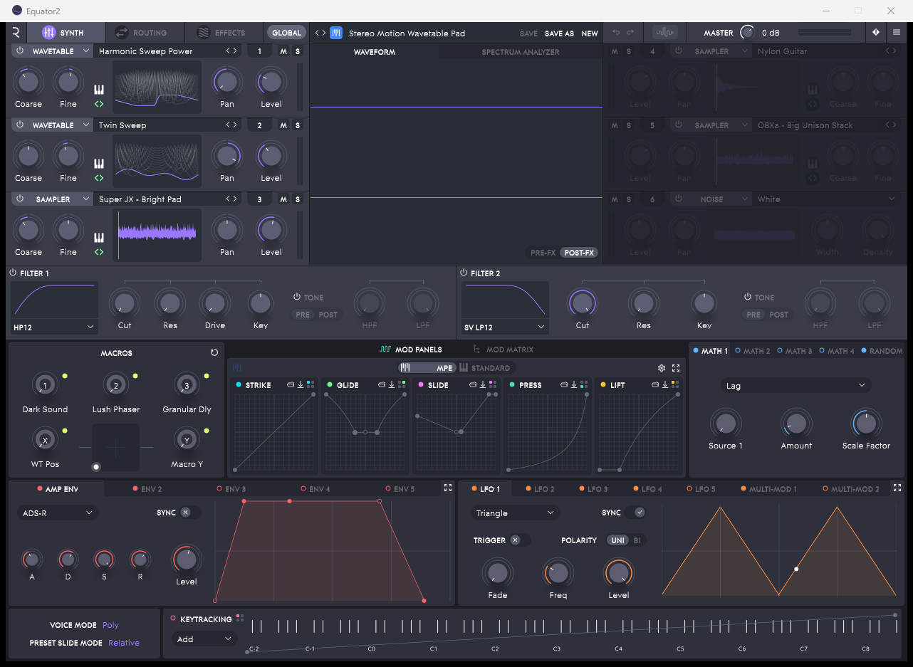
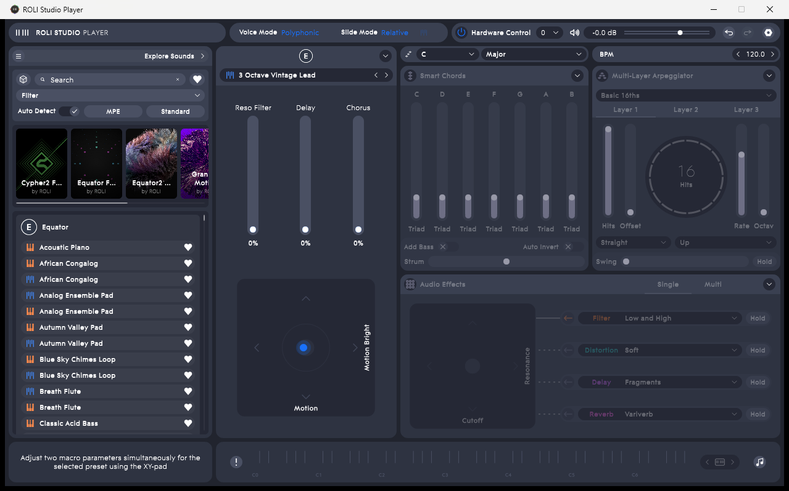
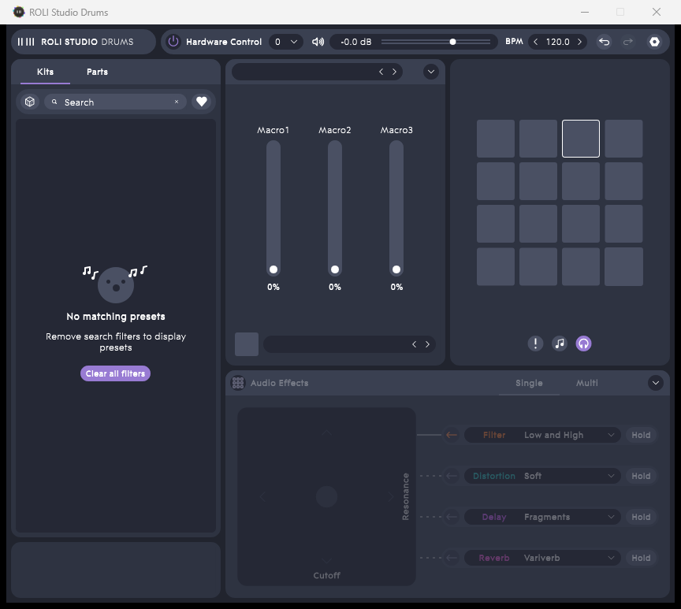

# ROLI Sunset Patcher

Restores offline use of ROLI software (Equator2, ROLI Studio Player, ROLI Studio Drums, ROLI Connect) on Windows, after ROLI's licensing servers were shut down and the company is no longer operating.

If you bought ROLI software, you should keep being able to use it. This tool does not connect to any server, does not ring home, and does not require any ROLI account. Everything happens on your own computer, and every change is reversible.

> **Note:** This is a restoration tool for products whose vendor is defunct. It is not a tool for bypassing active, live licensing. If a vendor is still operating, do not use this on their software.

---

## What this tool does

| # | Target | Change |
|---|--------|--------|
| 1 | `Equator2.exe` | 6-byte patch: the local license-check function now always answers "license valid" |
| 2 | `ROLI Studio Player.exe` | same |
| 3 | `ROLI Studio Drums.exe` | same |
| 4 | `Equator2.vst3` (DAW plugin) | same |
| 5 | `ROLI Studio Player.vst3` | same |
| 6 | `ROLI Studio Drums.vst3` | same |
| 7 | `ROLI Connect` (`app.asar`) | two small edits so Connect tolerates a dead login server and no longer wipes the offline license file |
| 8 | offline license file | installs a permanent, locally-generated license/entitlement file where the apps read it from |

The tool:

- **backs up every original file** to `%LOCALAPPDATA%\ROLI-Sunset\backup` before touching anything (with a manifest, so a restore is exact)
- is **idempotent** — running it twice is safe, it detects already-patched files
- supports **`-DryRun`** (scan and report, change nothing)
- supports **`-Restore`** (put everything back exactly as it was)





## What this tool does NOT do

- It cannot bring back **server-side content** (cloud preset syncing, online stores, account features). That data lived on dead servers.
- It does not affect your **ROLI keyboard/hardware** — the MIDI drivers are separate and keep working as before.
- It does not patch the macOS builds (this tool targets Windows).
- It does not change any audio, preset, or synth data.

## Requirements

- Windows 10 or 11 (64-bit)
- ROLI products already installed:
  - ROLI Connect (usually at `C:\Program Files\ROLI\ROLI Connect`)
  - Equator2, ROLI Studio Player, ROLI Studio Drums (installed by ROLI Connect)
- You are logged in as an **administrator** (the tool will ask for elevation/UAC)
- PowerShell 5.1 (built into Windows — nothing to install)

## Quick start

1. Close any running ROLI apps (check Task Manager for `Equator2`, `ROLI Studio Player`, `ROLI Studio Drums`, `ROLI Connect`).
2. Run the patcher (right-click the file → "Run with PowerShell", or from a terminal):

   ```powershell
   powershell -ExecutionPolicy Bypass -File .\ROLI-Sunset-Patcher.ps1
   ```

   A UAC prompt appears — click **Yes**. The script prints what it scans, patches, and backs up. It finishes with a `DONE` line.

   > Want to see what it *would* do without changing anything first? Add `-DryRun`.

3. Launch Equator2 / Player / Drums from the Start menu. They open straight into the full UI — no sign-in, no license screen.
4. Restart your PC and check once more. If it still works after reboot, you're done.

## Undoing it

```powershell
powershell -ExecutionPolicy Bypass -File .\ROLI-Sunset-Patcher.ps1 -Restore
```

This restores every backed-up original file (binaries, app.asar, license file) byte-for-byte, and removes the offline license file.

## Troubleshooting

| Symptom | Cause / fix |
|---------|-------------|
| Windows shows "Windows protected your PC" when you open the patched apps | Patching removes the digital signature the app shipped with, so SmartScreen notices. Click **More info → Run anyway**. It is expected and harmless. |
| Windows Defender flags the patcher | The script rewrites a few bytes in .exe files, which AV heuristics can flag. This tool is open-source — read it, verify it, and add it to your exclusions if needed. |
| PowerShell says "running scripts is disabled" | Use the `-ExecutionPolicy Bypass -File` form shown above (it applies per-run, doesn't change your system). |
| App still shows a license screen | A ROLI process was running while patching (file was locked). Close all ROLI processes and run the patcher again — it reports `already-patched` for files it already did and `=> error` for ones it couldn't touch. |
| A file shows `=> error: ... The process cannot access the file because it is being used by another process` | Same as above — close the app and re-run. |
| VST3 in your DAW loads but standalone doesn't (or vice versa) | Both are patched by the same tool; if one fails, check which DAW folders exist and that the file wasn't locked (DAW running). Close your DAW and re-run. |

## Where each patched file lives (default install)

```
C:\Program Files\ROLI\Equator2\Equator2.exe
C:\Program Files\ROLI\ROLI Studio Player\ROLI Studio Player.exe
C:\Program Files\ROLI\ROLI Studio Drums\ROLI Studio Drums.exe
C:\Program Files\Common Files\VST3\Equator2.vst3
C:\Program Files\Common Files\VST3\ROLI Studio Player.vst3\Contents\x86_64-win\ROLI Studio Player.vst3
C:\Program Files\Common Files\VST3\ROLI Studio Drums.vst3\Contents\x86_64-win\ROLI Studio Drums.vst3
C:\Program Files\ROLI\ROLI Connect\resources\app.asar
%APPDATA%\ROLI\Shared\%2Fapi%2Fv1%2Fuser%2F.json
%APPDATA%\ROLI\Shared\%2Fapi%2Fv1%2Fuser%2Fentitlements%2F.json
```

The tool doesn't hardcode these paths — it scans the standard install locations and finds files by their internal content signature, so it also works if you installed things in unusual places.

## Learn how this was done

This repo documents the whole process, written for people with **zero** reverse-engineering background:

| Doc | What you'll learn |
|-----|-------------------|
| [docs/01-how-roli-licensing-works.md](docs/01-how-roli-licensing-works.md) | How ROLI's licensing actually works: the login, the token, the offline file, the cryptographic signature. No prior knowledge assumed. |
| [docs/02-the-reverse-engineering-walkthrough.md](docs/02-the-reverse-engineering-walkthrough.md) | The step-by-step of how the patch was found and proven: real commands, real offsets, the test matrix, and why every decision was made. |
| [docs/03-beginners-guide-to-reverse-engineering.md](docs/03-beginners-guide-to-reverse-engineering.md) | The concepts and tooling for doing this kind of work yourself: hex, disassembly, x86-64 basics, what the 6-byte patch means, and how to practice legally. |

## Repo layout

```
ROLI-Sunset-Patcher.ps1   the tool (single file, no dependencies)
README.md                  you are here
docs/                      the learning material
assets/                    screenshots of the working result
```

## License & legal notes

- The **tool code** in this repository is licensed under the MIT License (see [LICENSE](LICENSE)).
- This tool exists because the vendor is defunct and its licensing infrastructure no longer exists, leaving previously purchased software unable to verify its own (already paid-for) license. It restores the function the vendor's dead servers used to provide.
- The patch does not copy, extract, or redistribute any of ROLI's proprietary code or content. It changes a few bytes in files you already own and are running, and writes a local file.
- You are responsible for how you use this on your system.
